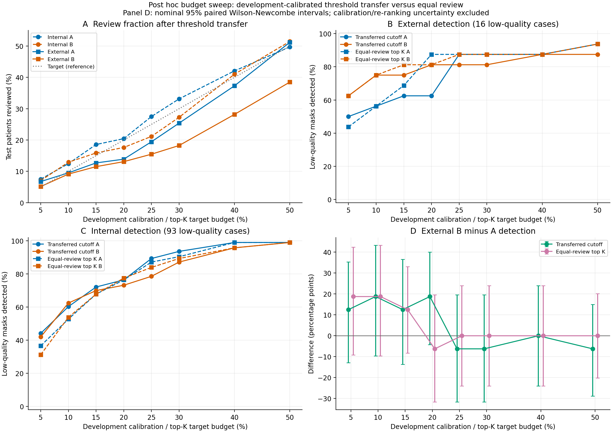
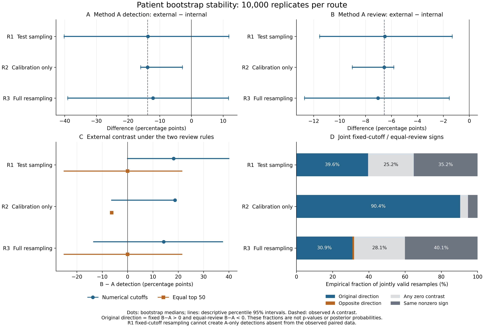
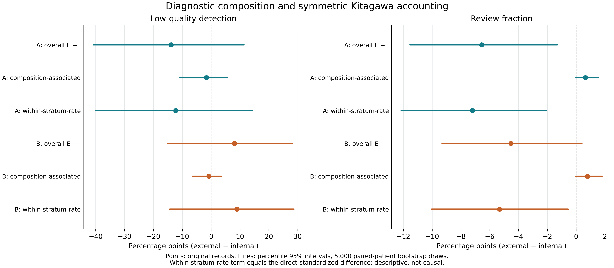

# 乳腺超声 v7：云端补充实验执行报告

三项事后验证已在当前 Codex 云端主机完成。它们围绕同一贡献补充证据：开发集锁定的数值阈值和测试队列中的等复核量排序，回答不同的部署问题；方法比较随决策规则和复核预算变化。

## 本轮能够回答什么

| 审稿关注 | 本轮执行 | 可用于论文的结果 |
| --- | --- | --- |
| 规则与排序的区别是否依赖20%单点 | 8个预算 × 两种规则 × 两个队列 | 完整预算响应及阈值迁移后的实际复核量 |
| 方向反转对阈值和抽样是否稳定 | 3条bootstrap路线，各10,000次 | 分开呈现校准变异与测试抽样变异 |
| 良恶性构成是否对应队列差异 | 对称分解、直接标准化、5,000次bootstrap | 把构成相关项与层内率项作描述性分账 |

## 主要结果

完整预算扫描中没有一种方法始终检出更多低质量掩膜。外部队列20%目标下，迁移阈值的 B−A 检出率差为 +18.75 个百分点，等复核50例时为 −6.25 个百分点；这种方向反转并未覆盖全部预算。

同时重采样开发集与测试队列时，原方向严格反转出现3,094/10,000次（30.94%）；任一差值为零占28.08%。这些是当前样本的经验重采样频率，不能解释为总体概率或p值。

A的外部减内部复核率差为 −6.56 个百分点，描述性分解为构成相关 +0.64 与层内率 −7.20 个百分点。按良恶性标准化后，该差异仍为负；这不是对设备、标注或提示框因素的因果排除。

## 范围与实际资源

使用冻结的213例开发、851例内部、252例外部逐例评分；低质量定义仍为参考 Dice <0.70。外部低质量独立病例仍为16例。原H1–H3、阈值和逐例评分均保留。三项计算没有执行模型训练或推理，也没有新增患者。

主机CPU配额2核，内存上限8 GiB；未发现GPU、PyTorch或精确SAM检查点。三项分析分别实际耗时约1.07、5.91、2.83秒（含各自导出/作图端点，互不相加为总墙钟时间）；不包含设计、代码审查或报告制作。

## 1. 全预算迁移与等复核量比较

目标预算固定为5%、10%、15%、20%、25%、30%、40%、50%。每个数值阈值只用开发集风险分数校准：risk≥cutoff、同分全纳入、选择最接近目标的可实现复核量，等距时取较少者；随后原样迁移到测试队列。等复核量另按队列内风险排序选K例，不重新拟合数值阈值。

| 目标 | 阈值复核A/B | 阈值检出A/B | 差值pp | 等量K | 等量检出A/B | 差值pp |
| --- | --- | --- | --- | --- | --- | --- |
| 5% | 17/13 | 8/10 | +12.50 | 13 | 7/10 | +18.75 |
| 10% | 24/23 | 9/12 | +18.75 | 25 | 9/12 | +18.75 |
| 15% | 32/29 | 10/12 | +12.50 | 38 | 11/13 | +12.50 |
| 20% | 35/33 | 10/13 | +18.75 | 50 | 14/13 | -6.25 |
| 25% | 49/39 | 14/13 | -6.25 | 63 | 14/14 | +0.00 |
| 30% | 64/46 | 14/13 | -6.25 | 76 | 14/14 | +0.00 |
| 40% | 94/71 | 14/14 | +0.00 | 101 | 14/14 | +0.00 |
| 50% | 129/97 | 15/14 | -6.25 | 126 | 15/15 | +0.00 |

表中复核分母均为252例，检出分母均为16例；差值均为B−A。完整内部/外部64行结果及配对Newcombe区间见CSV。所有预算一并报告，不用此网格选择有利预算。

20%开发阈值精确复现为A=0.13705134391784668、B=0.06972856653991777，均复核43/213例。外部实际复核率为13.89%与13.10%，较名义20%分别少6.11、6.90个百分点。

## 2. 阈值、抽样与排序的bootstrap稳定性

种子20261106，PCG64；每条路线10,000次。开发、内部、外部各自独立作患者级有放回抽样，患者的A/B评分与质量标签始终配对。重复抽中的患者记录全部保留。路线间共享相关抽样，以分开呈现校准与测试抽样变异。

| 路线 | 变化部分 | 原方向严格反转 | 任一差值为零 |
| --- | --- | --- | --- |
| 1 固定阈值 | 只重采样两个测试队列 | 3,961/10,000 (39.61%) | 25.19% |
| 2 校准变异 | 只重采样开发集并重校准 | 9,040/10,000 (90.40%) | 4.35% |
| 3 全部重采样 | 开发集重校准＋测试队列抽样 | 3,094/10,000 (30.94%) | 28.08% |

“原方向严格反转”定义为外部固定阈值 B−A>0 且等复核50例 B−A<0，零差值不计入。路线3反向反转占0.90%，同向且非零占40.08%。每条路线联合有效10,000次。

| 路线3终点 | 原始点估计pp | 百分位95%区间pp |
| --- | --- | --- |
| A检出率：外部−内部 | -13.84 | [-39.03, +11.71] |
| A复核率：外部−内部 | -6.56 | [-12.70, -1.55] |
| 外部固定阈值检出率：B−A | +18.75 | [-13.33, +37.50] |
| 外部等复核50例检出率：B−A | -6.25 | [-25.00, +21.43] |

## 关键解释：经验支持约束

原外部低质量病例中，固定阈值下10例两者都检出、0例仅A检出、3例仅B检出、3例均漏检。路线1无法从这些记录中生成“仅A检出”的未观测病例，因此其固定阈值B−A差值被结构性限制为非负，百分位区间[0,+40]不能用于排除总体中的A优势。原H3配对Newcombe区间[−4.28,+40.04]个百分点继续保留，不以bootstrap替换。

路线2的等复核50例差值恒为−6.25个百分点，因为测试队列与排序均未变化。其90.40%反转频率只描述给定测试病例时的校准敏感性。路线3的30.94%也不是“反转为真”的概率。区间跨零不构成等效性证据。

本轮没有发生低质量总分母为零的抽样；实现已独立测试NA分支。同分排序使用原patient_id字符串，随后按抽样出现序号破同分；从不去重。

## 2.1 三条重采样路线的结果图

## 可写入补充材料的英文结果段落

Across the complete budget grid, the relative detection yield depended on the review rule and target budget. In 10,000 joint development-and-test patient bootstrap replicates, the original strict direction pattern (external B-minus-A detection positive under transferred cutoffs and negative under equal-top50 review) occurred in 30.94%; at least one contrast was zero in 28.08%. These empirical resampling frequencies characterize the observed-sample sensitivity and are not population probabilities. The original prespecified Newcombe intervals were retained.

写作建议：以完整预算响应支持“决策规则决定比较含义”的主线，用bootstrap呈现其样本敏感性。主文保留原预设分析，新结果明确标注为事后探索性补充，避免把20%处的方向反转提升为普遍规律。

## 3. 诊断构成标准化与对称分解

在原锁定阈值下，对数据集报告的良性/恶性标签作两层分解（并非所有病例均经组织病理确认）。内部低质量53/40例，外部8/8例。检出率的构成权重使用低质量病例中的良恶性份额F层/F；复核率的权重使用全队列份额N层/N。

对称Kitagawa恒等式：外部−内部差异 = Σ(w外−w内)(p外+p内)/2 + Σ(p外−p内)(w外+w内)/2。两项分别称“构成相关项”和“层内率项”；共同权重(w外+w内)/2的直接标准化差值等于层内率项。

| 终点 | 总体差异pp [95%] | 构成相关项pp [95%] | 层内率项pp [95%] |
| --- | --- | --- | --- |
| A检出率 | -13.84 [-40.85, +11.40] | -1.62 [-10.89, +5.73] | -12.23 [-39.94, +14.30] |
| B检出率 | +8.13 [-15.09, +28.18] | -0.78 [-6.43, +3.62] | +8.91 [-14.32, +28.70] |
| A复核率 | -6.56 [-11.54, -1.31] | +0.64 [-0.01, +1.54] | -7.20 [-12.15, -2.08] |
| B复核率 | -4.53 [-9.31, +0.41] | +0.79 [-0.01, +1.80] | -5.32 [-10.03, -0.56] |

5,000次患者bootstrap，种子20261107；每次重算权重和层内率。检出率分解4,999次有效，另1次因外部良性低质量分母为零记NA；总体检出率和复核率均5,000次有效。恒等式最大绝对残差≤2.5×10⁻¹⁶（原始比例）。

A检出率差−13.84 = −1.62−12.23个百分点；A复核率差−6.56 = +0.64−7.20个百分点。两项是观察到的率与权重的代数分账，不能称为“病理导致的比例”或因果解释百分比，也不能排除设备、采集、标注和提示框差异。

## 4. 后续模型实验的可执行性与优先级

| 实验 | 执行条件与设计 | 当前状态 |
| --- | --- | --- |
| 六例漏检预测轮廓重放 | 使用原SAM ViT-B检查点、精确SHA-256、原提示和模型源码；保存真实预测并复核评分一致性 | 本机缺精确权重，官方下载域名未获网络允许；未执行推理 |
| 提示框扰动敏感性 | 预先固定±5%、±10%、±20%扰动网格；锁定质量定义；对同一病例配对比较；每档重新记录运行时间 | 需模型环境/权重；合成扰动不等于独立操作者框验证 |
| 独立提示框验证 | 由独立操作者在不知道参考掩膜和预测的条件下给框，再用锁定规则验证 | 需要新增人工标注；当前原始框来自参考掩膜，不能自行宣称已完成 |
| 更大独立外部验证 | 新增独立患者，预先固定阈值/规则/主要终点，再一次性验证 | 需要新的真实队列；bootstrap不能增加独立病例 |

六例重放的价值最高：直接回应审稿人对预测轮廓的要求。现有精确重放入口在v7的Analysis目录。检查点预期SHA-256为 ec2df62732614e57411cdcf32a23ffdf28910380d03139ee0f4fcbe91eb8c912。未用别的检查点、参考轮廓或其它已保存病例替代六例预测。

## 5. 复现、来源与交付说明

三项计算的源提交固定为 f9cfdc49b6e6a9e037443f6ce077006bc9377960。方案在本轮计算前固定，性质为事后探索性，不是原研究预注册。方案SHA-256：c34718732b856ab31d0d8ae19c88bbbf0f43a9614ea14433d8f62210cc1409c7。原字符串同分规则及整数预算的说明见clarification_addendum.json。

Python 3.12.14、NumPy 2.3.5、Matplotlib 3.10.8、openpyxl 3.1.5；单进程，数值线程设为1。逐输入与脚本哈希、全部bootstrap记录、有效次数、运行端点和独立复核记录随包交付。两份大CSV在归档版采用gzip无损压缩，原始CSV的SHA-256另存。

复现时使用README中的独立git worktree固定上述源提交，再向新输出目录运行三个脚本。不要在最新main上直接覆盖原记录；脚本会检查源提交与输入哈希。ZIP不打包原始影像或模型权重，所需来源与条款沿用仓库data及reproducibility说明。

通讯元数据：按作者本轮明确确认，两位作者均采用重庆医科大学缙云校区人工智能医学学院、大学城中路61号兰园6号楼、邮编400016。官方来源中的401331作为历史证据保留，当前作者通讯邮编以本次确认400016为准。

本报告用于作者审阅和后续整合。本轮未把新分析改为原预设主要终点，也未执行期刊投稿。

