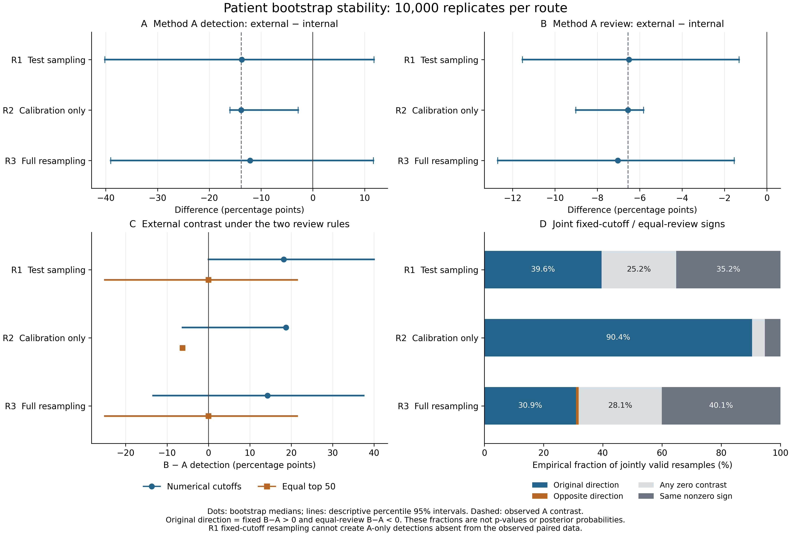

# Bootstrap threshold, sampling and ranking stability

This post hoc exploratory analysis follows the frozen cloud validation plan. It does not change the original locked analysis or replace its Newcombe intervals. No new model inference, training or independent patients were introduced.

## Principal descriptive findings

Under full resampling, the A detection contrast had a percentile interval of [-39.03, +11.71] pp, while its review-fraction contrast had an interval of [-12.70, -1.55] pp. The original strict direction pattern occurred in 3094/10000 jointly valid resamples (30.94%); the opposite pattern occurred in 0.90%, and at least one zero contrast occurred in 28.08%. These frequencies describe the observed-sample resampling experiment, not population probabilities.

## Observed values and design

The observed A external-minus-internal detection difference is -13.84408602 percentage points (pp), and its review difference is -6.55764460 pp. The external B-minus-A detection difference is +18.75 pp at the locked cutoffs and −6.25 pp when each method ranks and selects 50 cases. These were verified before resampling.

We used 10,000 iterations, seed 20261106, and one process with BLAS-related thread limits set to one. Independent NumPy SeedSequence child streams generated patient indices within development (213), internal (851) and external (252) cohorts. A/B scores and quality labels travelled together. The same draws were shared across relevant routes to isolate each source of variation; the three cohort streams remained independent.

Route 1 holds the original numerical cutoffs fixed and resamples both test cohorts. Route 2 resamples only development and recalibrates both 20% cutoffs while retaining the original test cohorts and original equal-top50 selections. Route 3 combines development recalibration with test-cohort resampling. Calibration keeps score ties together and chooses the attainable review count nearest 20%, with fewer reviews when equally close.

Each resampled external cohort retains 252 draw records, including repeated original patient IDs. Equal-review sorting is descending risk, original CaseID string, then draw-position replica index; it selects exactly 50 draw records without deduplication. These repeated draws represent empirical resampling, not additional patients.

## Descriptive percentile intervals

| Route | Endpoint | Observed, pp | Bootstrap median, pp | Percentile 95%, pp | Valid / total |
| --- | --- | ---: | ---: | --- | --- |
| 1. Fixed cutoffs; test sampling | H1: A detection, external − internal | -13.84 | -13.74 | [-40.16, +11.82] | 10000/10000 |
| 1. Fixed cutoffs; test sampling | H2: A review, external − internal | -6.56 | -6.51 | [-11.54, -1.31] | 10000/10000 |
| 1. Fixed cutoffs; test sampling | External fixed-cutoff B − A detection | +18.75 | +18.18 | [+0.00, +40.00] | 10000/10000 |
| 1. Fixed cutoffs; test sampling | External equal-top50 B − A detection | -6.25 | +0.00 | [-25.00, +21.43] | 10000/10000 |
| 2. Development calibration only | H1: A detection, external − internal | -13.84 | -13.84 | [-15.99, -2.82] | 10000/10000 |
| 2. Development calibration only | H2: A review, external − internal | -6.56 | -6.56 | [-9.02, -5.82] | 10000/10000 |
| 2. Development calibration only | External fixed-cutoff B − A detection | +18.75 | +18.75 | [-6.25, +18.75] | 10000/10000 |
| 2. Development calibration only | External equal-top50 B − A detection | -6.25 | -6.25 | [-6.25, -6.25] | 10000/10000 |
| 3. Full development + test sampling | H1: A detection, external − internal | -13.84 | -12.12 | [-39.03, +11.71] | 10000/10000 |
| 3. Full development + test sampling | H2: A review, external − internal | -6.56 | -7.04 | [-12.70, -1.55] | 10000/10000 |
| 3. Full development + test sampling | External fixed-cutoff B − A detection | +18.75 | +14.29 | [-13.33, +37.50] | 10000/10000 |
| 3. Full development + test sampling | External equal-top50 B − A detection | -6.25 | +0.00 | [-25.00, +21.43] | 10000/10000 |

## Empirical signs and direction reversal

All fractions below use jointly valid external contrasts as the denominator. Zero contrasts are reported separately and are never counted as a strict reversal. Full 3×3 fixed/equal sign matrices and the sign fractions for each endpoint are in summary.json.

| Route | Joint valid | Original direction: fixed>0, equal<0 | Opposite: fixed<0, equal>0 | Any zero contrast | Same nonzero sign |
| --- | ---: | --- | --- | --- | --- |
| 1. Fixed cutoffs; test sampling | 10000 | 3961/10000 (39.61%) | 0/10000 (0.00%) | 2519/10000 (25.19%) | 3520/10000 (35.20%) |
| 2. Development calibration only | 10000 | 9040/10000 (90.40%) | 0/10000 (0.00%) | 435/10000 (4.35%) | 525/10000 (5.25%) |
| 3. Full development + test sampling | 10000 | 3094/10000 (30.94%) | 90/10000 (0.90%) | 2808/10000 (28.08%) | 4008/10000 (40.08%) |

## Calibration and tie accounting

At the original locked thresholds, the external low-quality paired table has 10 detected by both, zero detected by A alone, three detected by B alone and three detected by neither. Route 1 resamples only these observed patient records, so it cannot create an A-only detection. Its fixed-cutoff B-minus-A contrast is structurally constrained to be nonnegative, producing a percentile interval [0.00,40.00] pp. That empirical-support constraint cannot exclude an A advantage in the population or establish equivalence/noninferiority. The original paired Newcombe interval [−4.28,+40.04] pp is retained and must not be replaced by the bootstrap interval. No smoothing, prior or invented discordant cases were introduced.

Route 2 necessarily retains −6.25 pp for the equal-top50 contrast because neither the test cases nor their rankings are changed. Variation in its fixed-cutoff contrast isolates development-calibration variability, rather than new test-sampling information.

| Route | Method | Cutoff percentile 95% | Median cutoff | Equal-top50 boundary split / total |
| --- | --- | --- | --- | --- |
| 1. Fixed cutoffs; test sampling | A | [0.137051344, 0.137051344] | 0.137051344 | 3629/10000 |
| 1. Fixed cutoffs; test sampling | B | [0.069728567, 0.069728567] | 0.069728567 | 3662/10000 |
| 2. Development calibration only | A | [0.095779777, 0.153415680] | 0.137051344 | 0/10000 |
| 2. Development calibration only | B | [0.059505982, 0.075878174] | 0.069728567 | 0/10000 |
| 3. Full development + test sampling | A | [0.095779777, 0.153415680] | 0.137051344 | 3629/10000 |
| 3. Full development + test sampling | B | [0.059505982, 0.075878174] | 0.069728567 | 3662/10000 |

A split boundary tie means that equal-top50 selects only part of a set of equal-risk draw records. It is allowed by the ranking rule and resolved by original CaseID and replica index. This differs from calibration, where a tied score group must be reviewed together. Complete boundary multiplicities and development review-count distributions are retained.

## Missing denominators and interpretation

- 1. Fixed cutoffs; test sampling: zero-low-quality denominators occurred in 0 internal and 0 external resamples. Affected detection contrasts are NA; review fractions remain defined.
- 2. Development calibration only: zero-low-quality denominators occurred in 0 internal and 0 external resamples. Affected detection contrasts are NA; review fractions remain defined.
- 3. Full development + test sampling: zero-low-quality denominators occurred in 0 internal and 0 external resamples. Affected detection contrasts are NA; review fractions remain defined.

These empirical fractions describe how often signs appear when resampling the observed patients under the stated rules. They are neither p-values nor posterior probabilities that a method is superior or that a reversal is a population property. Percentile intervals are descriptive bootstrap intervals and do not replace the original independent/paired Newcombe intervals. An interval spanning zero does not establish equivalence. The external sample contains only 16 observed low-quality cases; resampling does not remedy that limited independent information.

## Provenance and computation

- Source commit: `f9cfdc49b6e6a9e037443f6ce077006bc9377960`.
- Analysis plan SHA-256: `c34718732b856ab31d0d8ae19c88bbbf0f43a9614ea14433d8f62210cc1409c7`.
- Script SHA-256 during computation: `86bd575634946c8810b22b962bf4ac73f83ced3751c4f9a30c348ef140728720`.
- Bootstrap computation wall time: 4.042 s; CPU time: 4.037 s.
- Total recorded wall time through plot/CSV generation: 5.914 s.
- Peak process RSS: 189.5 MiB.
- All source input SHA-256 values, runtime library versions, RNG derivation, valid counts and boundary tests are recorded in summary.json. Source files were rehashed after computation and remained unchanged.
- Implementation is independent of the original study modules. Original point estimates and synthetic edge cases were checked before the full run. The repeated-ID and zero-denominator rules were exercised explicitly.
- `results/bootstrap_stability/iterations.csv` contains all three routes for every iteration. Undefined numbers or indicators use the literal NA. No zero-denominator detection value was imputed as zero.

