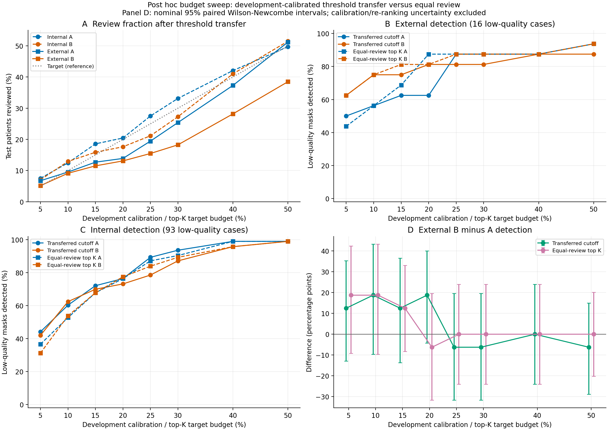

# Post hoc development-calibrated budget transfer

Ready within the specified deterministic score-analysis scope. All eight target budgets are reported; the original H1–H3 results are preserved.

Across the complete grid, external B-minus-A detection is positive at targets 5%, 10%, 15%, 20%; negative at 25%, 30%, 50%; and zero at 40% under transferred cutoffs. Under equal-review top K, it is positive at 5%, 10%, 15%; negative at 20%; and zero at 25%, 30%, 40%, 50%. Thus the 20% point-estimate reversal is budget-dependent rather than a uniform ranking advantage.

Development calibration uses only the 213 development risk scores and review counts, with whole tied groups under risk >= threshold and a zero-review option; labels do not select cutoffs. Each cutoff is transferred unchanged to the 851 internal and 252 external patients. Equal-review top K is a separate policy, with nearest-integer K (exact half ties choose fewer) and descending risk followed by the exact archived patient_id string, e.g. '1', '10', '100'; not integer or image-filename order. Internal N=851 at 50% selects K=425. Actual K is in performance.csv.

Low quality means reference Dice < 0.70. Low-quality denominators are 24 development, 93 internal and 16 external patients. Percentages below are descriptive. Intervals reuse the release's verified paired Wilson–Newcombe method 10 implementation; they are nominal 95% and do not include development-calibration or re-ranking uncertainty. There are no new significance tests or claims of equivalence.

## Development calibration (new budget sweep)

| Target | A cutoff | B cutoff | A reviews | B reviews | A TP/24 | B TP/24 |
|---:|---:|---:|---:|---:|---:|---:|
| 5% | 0.23009788990020752 | 0.14339529755213554 | 11/213 | 11/213 | 6 | 7 |
| 10% | 0.18737196922302246 | 0.091432393120102207 | 21/213 | 21/213 | 11 | 10 |
| 15% | 0.15341567993164062 | 0.075878174437707058 | 32/213 | 32/213 | 17 | 13 |
| 20% | 0.13705134391784668 | 0.069728566539917769 | 43/213 | 43/213 | 19 | 17 |
| 25% | 0.099984049797058105 | 0.060165860850763586 | 53/213 | 53/213 | 21 | 19 |
| 30% | 0.082495152950286865 | 0.052356278741599427 | 64/213 | 64/213 | 21 | 23 |
| 40% | 0.060212433338165283 | 0.034317723700779013 | 85/213 | 85/213 | 21 | 24 |
| 50% | 0.051672816276550293 | 0.023950986734323054 | 106/213 | 106/213 | 23 | 24 |

## Internal BUS-BRA (N=851, F=93)

| Target | Policy | A R/N | B R/N | A TP/F (misses) | B TP/F (misses) | B−A detection pp (95% CI) |
|---:|---|---:|---:|---:|---:|---:|
| 5% | Transferred cutoff | 64/851 | 60/851 | 41/93 (52) | 39/93 (54) | -2.15 (-10.64, 6.41) |
| 5% | Equal-review top K | 43/851 | 43/851 | 34/93 (59) | 29/93 (64) | -5.38 (-14.57, 3.95) |
| 10% | Transferred cutoff | 106/851 | 110/851 | 56/93 (37) | 58/93 (35) | 2.15 (-6.43, 10.67) |
| 10% | Equal-review top K | 85/851 | 85/851 | 49/93 (44) | 50/93 (43) | 1.08 (-7.20, 9.32) |
| 15% | Transferred cutoff | 158/851 | 135/851 | 67/93 (26) | 65/93 (28) | -2.15 (-12.16, 7.91) |
| 15% | Equal-review top K | 128/851 | 128/851 | 63/93 (30) | 63/93 (30) | 0.00 (-10.00, 10.00) |
| 20% | Transferred cutoff | 174/851 | 150/851 | 71/93 (22) | 68/93 (25) | -3.23 (-13.48, 7.09) |
| 20% | Equal-review top K | 170/851 | 170/851 | 71/93 (22) | 72/93 (21) | 1.08 (-9.27, 11.40) |
| 25% | Transferred cutoff | 234/851 | 180/851 | 83/93 (10) | 73/93 (20) | -10.75 (-20.42, -1.21) |
| 25% | Equal-review top K | 213/851 | 213/851 | 81/93 (12) | 78/93 (15) | -3.23 (-12.88, 6.39) |
| 30% | Transferred cutoff | 282/851 | 232/851 | 87/93 (6) | 81/93 (12) | -6.45 (-15.45, 2.30) |
| 30% | Equal-review top K | 255/851 | 255/851 | 84/93 (9) | 83/93 (10) | -1.08 (-9.94, 7.74) |
| 40% | Transferred cutoff | 358/851 | 349/851 | 92/93 (1) | 89/93 (4) | -3.23 (-9.55, 2.26) |
| 40% | Equal-review top K | 340/851 | 340/851 | 92/93 (1) | 89/93 (4) | -3.23 (-9.55, 2.26) |
| 50% | Transferred cutoff | 423/851 | 438/851 | 92/93 (1) | 92/93 (1) | 0.00 (-4.86, 4.86) |
| 50% | Equal-review top K | 425/851 | 425/851 | 92/93 (1) | 92/93 (1) | 0.00 (-4.86, 4.86) |

## External BrEaST (N=252, F=16)

| Target | Policy | A R/N | B R/N | A TP/F (misses) | B TP/F (misses) | B−A detection pp (95% CI) |
|---:|---|---:|---:|---:|---:|---:|
| 5% | Transferred cutoff | 17/252 | 13/252 | 8/16 (8) | 10/16 (6) | 12.50 (-12.93, 35.34) |
| 5% | Equal-review top K | 13/252 | 13/252 | 7/16 (9) | 10/16 (6) | 18.75 (-9.16, 42.38) |
| 10% | Transferred cutoff | 24/252 | 23/252 | 9/16 (7) | 12/16 (4) | 18.75 (-9.64, 43.30) |
| 10% | Equal-review top K | 25/252 | 25/252 | 9/16 (7) | 12/16 (4) | 18.75 (-9.64, 43.30) |
| 15% | Transferred cutoff | 32/252 | 29/252 | 10/16 (6) | 12/16 (4) | 12.50 (-13.65, 36.54) |
| 15% | Equal-review top K | 38/252 | 38/252 | 11/16 (5) | 13/16 (3) | 12.50 (-8.31, 33.02) |
| 20% | Transferred cutoff | 35/252 | 33/252 | 10/16 (6) | 13/16 (3) | 18.75 (-4.28, 40.04) |
| 20% | Equal-review top K | 50/252 | 50/252 | 14/16 (2) | 13/16 (3) | -6.25 (-31.61, 19.57) |
| 25% | Transferred cutoff | 49/252 | 39/252 | 14/16 (2) | 13/16 (3) | -6.25 (-31.61, 19.57) |
| 25% | Equal-review top K | 63/252 | 63/252 | 14/16 (2) | 14/16 (2) | 0.00 (-23.96, 23.96) |
| 30% | Transferred cutoff | 64/252 | 46/252 | 14/16 (2) | 13/16 (3) | -6.25 (-31.61, 19.57) |
| 30% | Equal-review top K | 76/252 | 76/252 | 14/16 (2) | 14/16 (2) | 0.00 (-23.96, 23.96) |
| 40% | Transferred cutoff | 94/252 | 71/252 | 14/16 (2) | 14/16 (2) | 0.00 (-23.96, 23.96) |
| 40% | Equal-review top K | 101/252 | 101/252 | 14/16 (2) | 14/16 (2) | 0.00 (-23.96, 23.96) |
| 50% | Transferred cutoff | 129/252 | 97/252 | 15/16 (1) | 14/16 (2) | -6.25 (-28.81, 15.01) |
| 50% | Equal-review top K | 126/252 | 126/252 | 15/16 (1) | 15/16 (1) | 0.00 (-20.20, 20.20) |

## External budget drift after threshold transfer

The full CSV also gives external-minus-development and external-minus-internal achieved review fractions. Drift below is relative to the nominal target, not a fitted correction.

| Target | A actual review | B actual review | A minus target pp | B minus target pp |
|---:|---:|---:|---:|---:|
| 5% | 6.75% | 5.16% | +1.75 | +0.16 |
| 10% | 9.52% | 9.13% | -0.48 | -0.87 |
| 15% | 12.70% | 11.51% | -2.30 | -3.49 |
| 20% | 13.89% | 13.10% | -6.11 | -6.90 |
| 25% | 19.44% | 15.48% | -5.56 | -9.52 |
| 30% | 25.40% | 18.25% | -4.60 | -11.75 |
| 40% | 37.30% | 28.17% | -2.70 | -11.83 |
| 50% | 51.19% | 38.49% | +1.19 | -11.51 |

## Preservation and reproducibility

At 20%, A = 0.13705134391784668 and B = 0.06972856653991777, each selecting 43/213 development cases. All original H1–H3 result JSON fields match the locked archive exactly. This is a new development-calibrated grid of transferred numerical cutoffs, rather than a redraw of the original test-cohort ranking curve.

The external sample contains only 16 low-quality masks; individual detections change its fraction by 6.25 percentage points. The all-budget grid must not be used to select a favorable budget or promote a post hoc contrast to a primary result.

Actual deterministic analysis and rendering time: 1.071 seconds. Seed: not applicable (no random operations). Source commit: `f9cfdc49b6e6a9e037443f6ce077006bc9377960`. The recorded cgroup quota is `200000 100000` CPU and `8589934592` bytes memory.

Source/protocol/script hashes, exact full-precision values, intervals and verification results are in `results/budget_transfer/results.json`. Full tables are `calibration.csv`, `performance.csv` and `paired_contrasts.csv`; per-policy selected string CaseIDs are preserved in `selected_case_ids.json`. Figures are `figures/budget_transfer.png` and `.pdf`.

